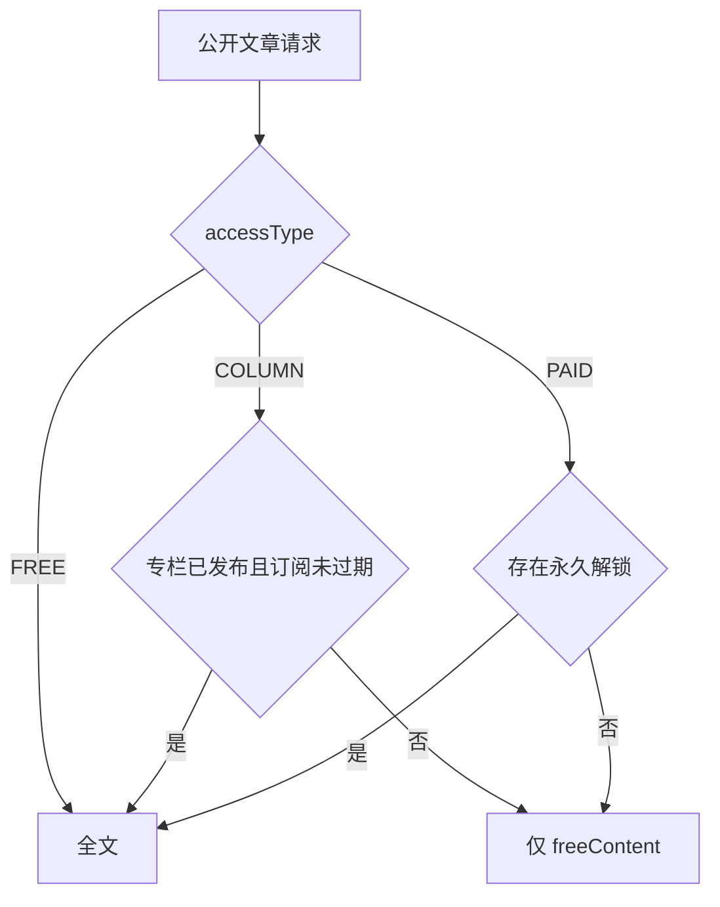

# 专栏与付费文章设计方案

## 1. 背景与目标

- 当前问题：文章只有公开阅读。没有专栏、周期订阅、单篇付费，也没有不依赖支付的开通方式。付费正文如果整篇下发，搜索引擎和接口都会泄露付费段。
- 目标用户与场景：
  - 创作者创建专栏，把文章设为免费、专栏或单篇付费，并用兑换码开通读者权限。
  - 读者用兑换码订阅专栏（30 / 90 / 365 天），或永久解锁单篇付费文章；订阅有效期内可反复阅读该专栏文章，过期后不能再看付费段。
  - 读者和作者都能查看完整的订阅与解锁记录。
  - 未接入支付的站点仍能跑通同一套阅读权。
- 成功标准：
  - 阅读权只有一个解析入口：公开接口、搜索和页面源码都不会带出付费段。
  - 文章访问类型为 `FREE` / `COLUMN` / `PAID` 三选一。
  - 专栏订阅按自然日时长累计；单篇付费兑换后永久有效。
  - 兑换码单次使用；并发兑换不会把同一码用两次。
  - 每篇内容在保存时按第一次 `<!--free-->` 派生免费段，供未授权读者和 SEO 使用。
- 非目标：本期不实现收银台、渠道回调和自动续费。价格、订单、支付尝试和退款必须先落在表结构里，方便以后直接开发。一篇文章不加入多个专栏，专栏文章不再单篇购买，兑换码不转赠、不多次使用。不由 AI 生成 Prisma migration。

## 2. 现状与约束

- 现有架构：文章拆成 `ArticleBase`（跨语言）和 `ArticleContent`（按 `languageCode`）。公开详情在 `server/api/articles/[slug].get.ts`，直接返回全文。搜索在 `server/api/articles/search.get.ts`，标题不足时用正文 `content` 补齐，但响应只有 id、slug、标题和语言。创作者在 `app/pages/admin/editpost.client.vue` 编辑 Markdown。读者个人页在 `app/pages/my/`。接口前缀约定：`/api/entry` 登录用户、`/api/creator` 创作者、`/api/admin` 管理员。
- 技术约束：约定式枚举（`String` 注释允许值，不用 Prisma `enum`）；约定式外键（不用 `@relation`）；多语言用 `languageCode`。见 `docs/development-database-guidelines.md`。实现时只改 `prisma/schema.prisma`，由开发者自行生成 migration。
- 已知缺口：没有任何订阅、解锁或正文裁剪。存量文章全部视为公开全文。

## 3. 方案概览

专栏与文章访问类型分开建模。本期运行时只写入兑换开通（`source = REDEEM`），但价格和交易表按支付接入后的结构建好。阅读权由单一函数判定：作者和管理员始终看全文；`FREE` 公开全文；`COLUMN` 仅在专栏已发布且订阅未过期时看全文；`PAID` 仅在存在永久解锁时看全文。其余情况只返回该语言的 `freeContent`。

作者本人和管理员在进入上图之前直接得到全文。专栏未发布时，即使订阅未过期，前台也不放行全文；订阅倒计时继续走。

## 4. 详细设计

### 4.1 数据模型与权威来源

物理表名用蛇形复数，主键 `cuid`，时间戳与现有模型一致。关联只存 id，由业务代码校验。

`Column`（对齐 `ArticleBase` 的跨语言基础信息）：

- `authorId`：创作者对应的 `User.id`
- `featuredImage`：封面，可空
- `status`：`DRAFT` / `PUBLISHED`
- `isPublished`：与 `status` 同步，前台是否可发现、订阅是否放行全文都看它
- `currency`：可空，ISO 4217。该专栏各订阅档共用；未标价时为空

`ColumnContent`（每种语言一条）：

- `columnId`、`languageCode`
- `slug`、`title`、`description`
- `seoTitle`、`seoDescription`、`seoKeyword`，均可空
- 唯一约束：`(columnId, languageCode)`、`(slug, languageCode)`

`ArticleBase` 新增：

- `accessType`：`FREE` / `COLUMN` / `PAID`，默认 `FREE`
- `columnId`：可空。仅 `COLUMN` 允许有值，且该专栏的 `authorId` 必须等于文章 `authorId`。`FREE` 与 `PAID` 必须为空
- `priceAmount`、`currency`：仅 `PAID` 使用。金额是最小货币单位的整数，空表示尚未标价。不使用小数金额

`ArticleContent` 新增：

- `freeContent`：可空文本。保存时从正文派生，不是作者另填的字段

`content` 仍是作者原文，保留 `<!--free-->`。`freeContent` 是派生结果，保存时覆盖，不单独编辑。

`ColumnSubscription`：当前权益，`(userId, columnId)` 唯一。

- `startsAt`、`expiresAt`
- `source`：`REDEEM` / `PAYMENT`。本期写入只有 `REDEEM`
- `orderId`：最近一次支付开通的订单，兑换时为空
- 未过期再次兑换：`expiresAt` 从当前值顺延，`startsAt` 不变
- 已过期再次兑换：`startsAt` 改为兑换时刻，`expiresAt` 从该时刻重算

`ColumnSubscriptionLog`：不可修改的流水，每次成功兑换一条。

- `userId`、`columnId`、`source`
- `redeemCodeId`、`orderId`：二选一。兑换流水指向兑换码，支付流水指向订单，且 `orderId` 唯一
- `durationDays`：30、90 或 365
- `previousExpiresAt`：顺延前的到期时间，首次或过期后重开则为空
- `appliedFrom`、`appliedTo`：本段实际覆盖的区间

`ColumnRedeemCode`：

- `columnId`、`code`（全局唯一、作者可见明文）
- `durationDays`：仅 30 / 90 / 365
- `status`：`UNUSED` / `USED` / `REVOKED`
- `createdBy`、`usedBy`、`usedAt`
- 单次使用。单次生成不超过 100 个。码长 16，字符集去掉易混字符（如 `0/O`、`1/I/L`）

`ArticleUnlock`：永久解锁，`(userId, articleBaseId)` 唯一。

- `source`：`REDEEM` / `PAYMENT`
- `redeemCodeId` 或 `orderId`：兑换或支付二选一，`orderId` 唯一
- `unlockedAt`
- 不设到期时间

`ColumnPlan`：专栏的在售档位。`(columnId, durationDays)` 唯一，`durationDays` 仅 30 / 90 / 365，`amount` 为最小货币单位，货币读 `Column.currency`。没有某一档的行表示该时长尚未标价。`isActive = false` 只影响以后开售，不改已有订阅。

`CommerceOrder`：购买单。兑换码不产生订单。

- `userId` 买家，`authorId` 卖家快照
- `status`：`PENDING` / `PAID` / `CLOSED` / `REFUNDING` / `REFUNDED`
- `productType`：`COLUMN_SUBSCRIPTION` / `ARTICLE_UNLOCK`
- `columnId` 或 `articleBaseId`，专栏单另有 `durationDays`
- `amount`、`currency`：下单时的应付金额
- `provider`、`providerOrderId`：渠道标识和渠道订单号，未选渠道时为空
- `idempotencyKey`：客户端重试去重
- `paidAt`、`closedAt`、`refundedAt`

`CommercePayment`：一次支付尝试。一笔订单可以有多条。`status` 为 `PENDING` / `SUCCEEDED` / `FAILED`。`payload` 只存渠道回调原文，阅读权以订单 `PAID` 为准。

`CommerceRefund`：退款，金额可以小于订单金额。`status` 为 `PENDING` / `SUCCEEDED` / `FAILED`。退款是否收回阅读权不由这张表自动决定。

`ArticleRedeemCode`：绑定一篇 `accessType = PAID` 的文章，字段与专栏兑换码相同，但没有 `durationDays`。文章改离 `PAID` 后，未使用的码不可再兑；已有解锁记录保留，但不再授予这篇的阅读权。

改 `accessType` 或更换 `columnId` 立即影响之后的判定，不迁移旧订阅，也不迁移旧解锁。

### 4.2 API、权限与错误语义

公开文章详情和搜索必须调用同一个访问解析。无权限时详情只返回 `freeContent`、访问类型、锁定原因（未订阅 / 已过期 / 未解锁），以及专栏标识（若是专栏文章）。有权限时返回去掉第一次 `<!--free-->` 之后的全文，响应里不带这个标记。

公开搜索只匹配标题和 `freeContent`。不再用付费段 `content` 补齐结果。搜索响应继续只含定位字段，不返回正文片段。

站点地图可以继续列出已发布文章和专栏的公开 URL，便于收录免费段页面。地图和任何公开接口都不得包含付费段正文。

建议路径（沿用现有前缀，实现时再按项目结果包装）：

- 公开：`GET /api/columns/[slug]` 专栏简介与文章列表（列表只含标题、摘要、封面、锁定状态）
- 创作者：专栏 CRUD、文章访问类型、批量发码、作废未使用码、本专栏订阅人与流水、本篇文章的解锁与兑换码
- 登录读者：`/api/entry` 下兑换、我的订阅（含剩余天数和流水）、我的永久解锁
- 管理员：只读列出全部专栏、订阅和兑换记录。不能发码，不能改别人的专栏或文章访问类型

兑换错误：

- 码不存在、已使用、已作废：失败，不改变权益
- 专栏未发布、文章不是 `PAID`、文章未发布：失败，不消耗码
- 兑换自己的专栏码或自己的文章码：失败，不消耗码
- 已经永久解锁该文：失败，不消耗文章码
- 专栏码在有效期内或过期后再次使用另一枚未使用码：成功，并按第 4.1 节续期

作者和管理员不需要兑换自己的内容，因为解析时已经放行全文。

### 4.3 状态、缓存、并发与幂等

兑换放在一个事务里：先按 `status = UNUSED` 条件更新为 `USED` 并写入使用者；更新行数为 0 则整单失败。然后再写入或更新 `ColumnSubscription` / `ArticleUnlock`，并追加流水。不允许先改权益再改码。

当前是否有效只由 `expiresAt > now` 判定，不另存一份会过期的 `ACTIVE` 状态。列表筛“有效 / 已过期”时按查询时刻计算。

同一用户同一专栏的并发兑换靠订阅行更新串行化到事务里；以条件更新兑换码作为第一道互斥。重复提交同一已使用码返回已使用，不延长订阅。

`freeContent` 在创建、更新、AI 生成入库、翻译入库时重算。读取时不再扫描标记，避免各接口各切一次。

### 4.4 UI、交互与信息架构

创作者后台：

- 专栏列表、新建和编辑。多语言内容的编辑方式对齐文章：基础信息一份，每种语言一条标题、简介和 slug。
- 文章编辑页增加访问类型：免费、专栏、单篇付费。选专栏时只列出自己的专栏。选专栏或单篇付费时提供插入 `<!--free-->` 的动作，并预览第一次标记之前的免费段。
- 专栏兑换码：选择 30 / 90 / 365、数量（1 到 100）、生成、复制、作废未使用码。已使用码展示使用者和时间。
- 单篇付费兑换码挂在该文章上，规则相同，但没有时长。
- 订阅记录：按专栏、有效/已过期、用户、时间筛选；点开可见每次流水的时长、顺延前到期时间和本段区间。

读者：

- 专栏页展示简介、文章列表和兑换框。锁定文章页渲染免费段（可为空）和付费墙，付费墙说明专栏名或“单篇付费”，已过期时显示到期时间，并提供兑换框。
- `app/pages/my/` 增加我的订阅和我的解锁。订阅列出专栏、起止时间、剩余天数、有效或已过期，以及该专栏的兑换流水。解锁列出永久可读的文章。

管理员后台只提供只读记录，不提供发码和编辑。

前台文章 URL 保持公开。未授权时页面仍可打开，正文区域只有免费段和付费墙。

### 4.5 国际化、主题与响应式

专栏文案、付费墙、兑换结果、订阅状态写入现有 locale 文件，至少覆盖站点已启用语言。专栏内容本身按 `ColumnContent.languageCode` 存储，缺当前语言时沿用文章详情的现有回退方式。

新页面使用现有后台布局和前台排版，不新增视觉体系。桌面与移动都要能完成：创建专栏、设置访问类型、生成并复制兑换码、兑换、查看过期订阅。明暗主题沿用现有令牌。空列表、码无效、专栏无文章、免费段为空，都要有明确状态，而不是空白区域。

### 4.6 日志、审计、隐私与安全

`ColumnSubscriptionLog` 和兑换码的 `usedBy` / `usedAt` 是审计来源。作者只能看自己专栏和自己文章的记录。管理员只读全站记录。读者只能看自己的订阅、流水和解锁。

兑换码明文只出现在创作者的码列表和读者输入框，不写入公开文章接口。公开响应在无权限时不得包含 `content` 付费段，也不得包含标记之后的原文。服务端裁剪，不能只靠前端隐藏。

付费段不得进入搜索匹配、站点地图正文、页面源码和日志中的文章正文。错误信息只说明码无效、已使用、已作废或无权兑换，不回显其他用户的码。

## 5. 失败与恢复

- 外部依赖失败：本期兑换不调用支付。数据库事务失败则码和权益都不变。
- 部分成功：禁止出现“码已标记使用但订阅未写入”。两者必须在同一事务。
- 重试与幂等：读者重复提交已使用的码得到已使用，订阅时长不变。已解锁后再兑文章码不消耗新码。
- 用户恢复路径：码作废后作者可再生成。订阅过期后使用新的未使用码，从兑换时刻重新起算。作者改回 `FREE` 后，读者无需兑换即可看全文。

## 6. 兼容与数据处理

- 存量数据：现有文章 `accessType` 默认 `FREE`，`columnId` 为空，`freeContent` 为空。行为与现在一致，公开全文。
- 旧客户端 / 旧 URL / 旧缓存：文章 slug 不变。上线前被缓存的全文会在缓存过期前仍可能含付费段；实现时公开文章响应需要避免把付费正文写入可被匿名复用的缓存。本期没有旧专栏 URL。
- Prisma：只修改 `prisma/schema.prisma`。开发者自行生成并执行 migration。新增字段使用默认值或可空，避免逼存量行填专栏。
- 回滚边界：回滚代码后，新表可以留在库里不用。若回滚前已有 `COLUMN` / `PAID` 文章，旧代码会把全文公开，因此回滚前应先把这些文章改回 `FREE`，或保留新的公开接口裁剪。

免费段切分规则（保存、AI 入库、翻译入库共用）：

- 标记固定为 `<!--free-->`，大小写和连字符都按这个字符串匹配。
- 只认第一次出现。标记之前的文本写入 `freeContent`，不含标记本身。
- 没有标记时 `freeContent` 为空。未授权读者只看到标题、摘要和付费墙。
- 第一次之后的标记留在付费段，不再切分。
- 各语言正文独立保存。某语言译文丢掉标记，该语言就没有免费段。

## 7. 实施顺序

1. 在 schema 增加上述模型和 `ArticleBase` / `ArticleContent` 字段，并抽出免费段切分与访问解析。不写 migration 文件。
2. 文章保存、AI 生成、翻译入库写入 `freeContent`。公开详情和搜索改走访问解析。
3. 创作者专栏、发码、作废、订阅记录，以及读者兑换、我的订阅、我的解锁。
4. 文章编辑页的访问类型和标记插入。专栏页、锁定文章付费墙。管理员只读列表。
5. 补齐 locale。为切分、续期、兑换并发和“无权限响应不含付费段”加测试。变更记录写入 `changelog/`。

## 8. 验证与验收

- 自动化检查：免费段只取第一次标记；无标记时免费段为空；有效期内兑换从 `expiresAt` 顺延；过期后从当前时刻起算；同一码并发只有一次成功；已解锁不消耗文章码；不能兑自己的码；无权限的详情和搜索条件都不含付费段。
- 边界：标记在文首；标记出现两次；专栏未发布但订阅未过期；文章从专栏改成单篇付费或免费；兑换码作废；数量 100 与 101。
- 人工：创作者发码、读者兑换、过期后付费墙、我的订阅流水、移动端兑换框。本期无支付沙箱。
- 发布前：确认开发者已生成 migration；抽查匿名请求文章接口的 JSON，确认没有付费段。

## 9. 风险与待决策

| 项目 | 影响 | 建议 | 决策状态 |
| --- | --- | --- | --- |
| 单篇付费为永久解锁 | 解锁表无到期字段 | 兑换成功即永久有效 | 已确认 |
| 访问类型三选一 | 专栏文章不能再单篇购买 | `COLUMN` 与 `PAID` 互斥，一篇文章最多一个 `columnId` | 已确认 |
| 本期不做收银台 | 运行时仍只写兑换开通 | 价格、订单、支付尝试、退款先建表，渠道接入时直接使用 | 已确认 |
| 续期从到期时间顺延 | 提前兑换不会丢掉剩余天数 | 过期后才从兑换时刻重算，流水保留 | 已确认 |
| 未授权仍公开免费段 | 过期后仍能看标记前内容，这是 SEO 所需 | 付费段不下发；无标记则正文为空 | 已确认 |
| 管理员只读 | 不能代作者发码或改专栏 | 作者管理自己的专栏和码 | 已确认 |
